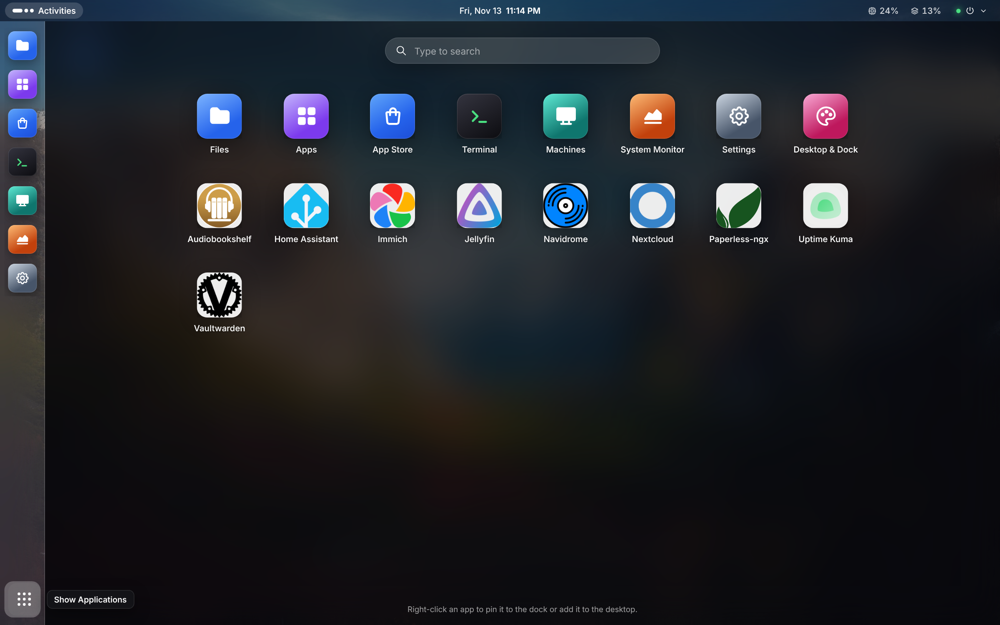
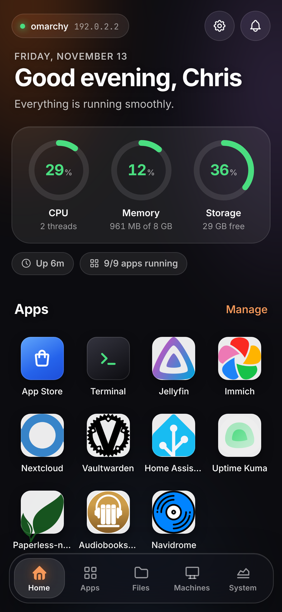
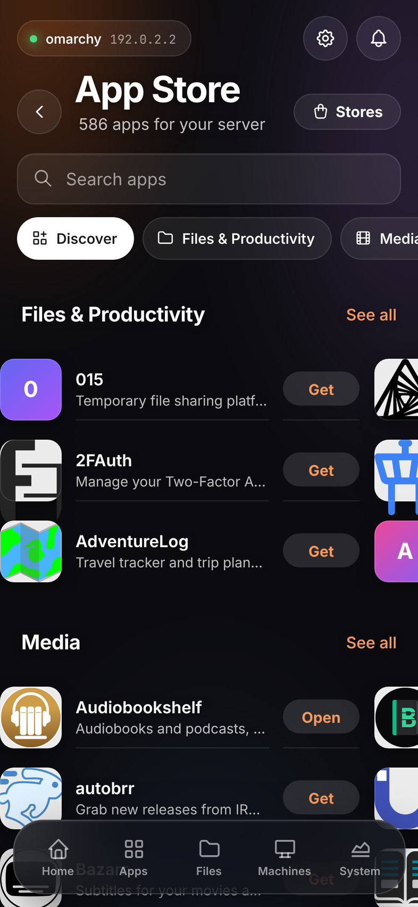
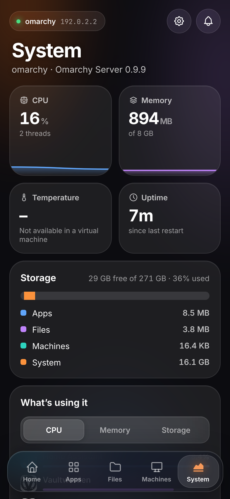
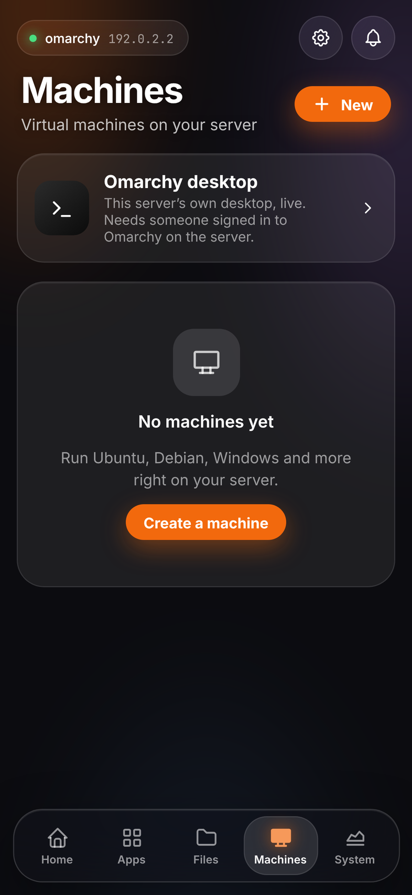
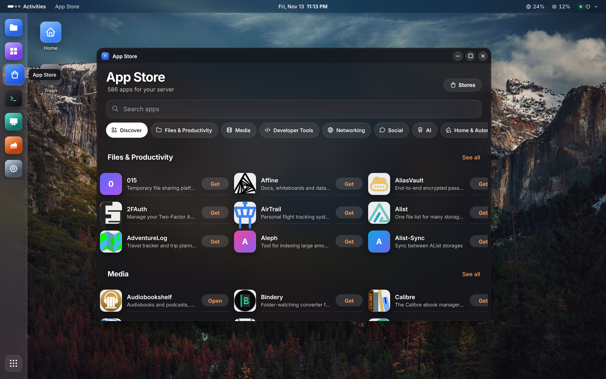
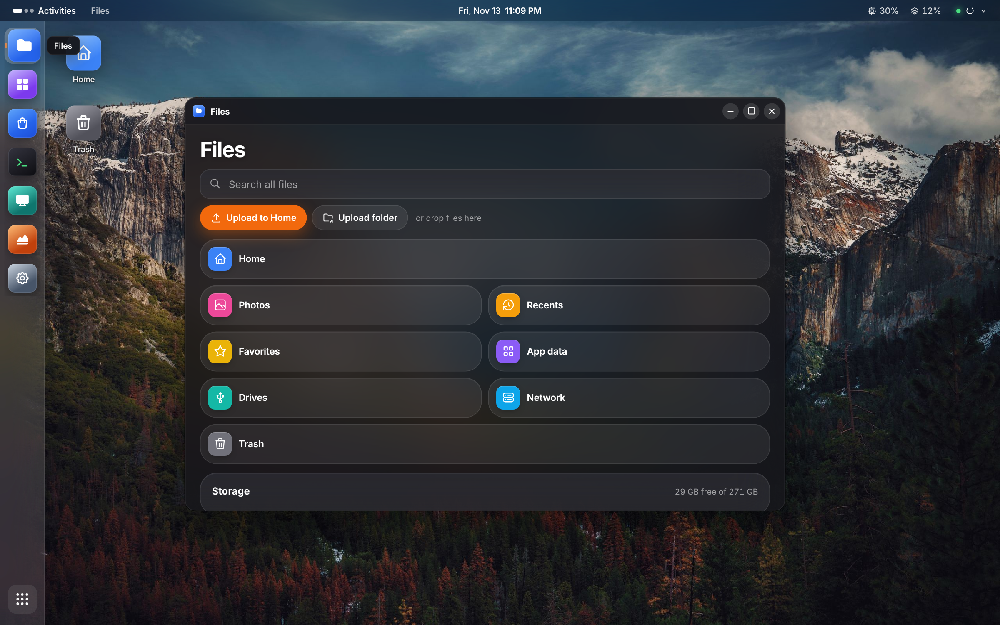
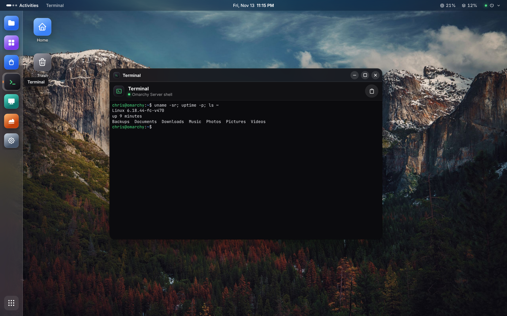
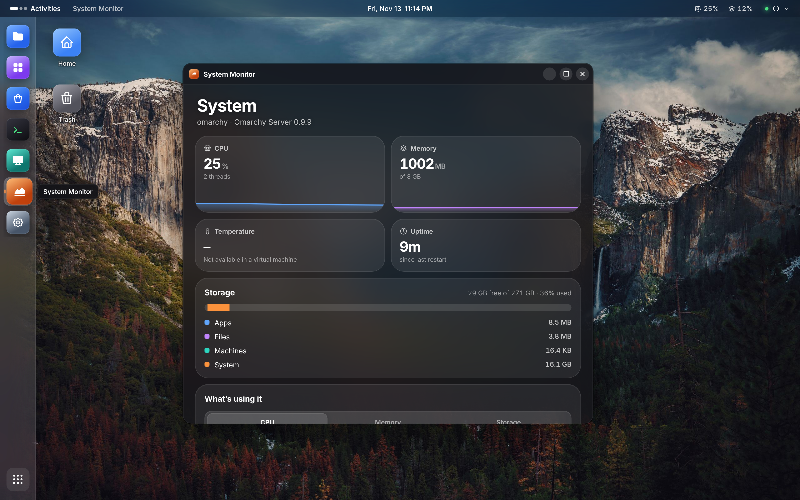

# Omarchy Server

Turn an [Omarchy](https://omarchy.org) machine into a home server you run from any browser. Install
apps from a catalog of about 580, keep your files and drives in one place, run virtual machines, and
reach your real Omarchy desktop — from a phone, a tablet or another computer.



<p align="center">
  
  
  
  
</p>

## Install

On the Omarchy machine, as your normal user (not with sudo):

```sh
curl -fsSL https://raw.githubusercontent.com/TouchWorkStation/omarchy-server/main/install.sh | bash
```

The installer:

- installs what's missing (Node.js, Podman, libvirt, wayvnc and friends);
- builds Omarchy Server in `~/.local/share/omarchy-server`;
- asks you to create your account **in the terminal**, so your password never crosses the network;
- starts two systemd user services that keep running while you're logged out.

Then open `http://<server-ip>:7780` (or `https://`, see [Security](#security)) and sign in.

Run the same command again to update, or use Settings → Software update. Your account, apps, machines
and files are kept. Logs: `journalctl --user -u omarchyd -u omarchy-server-web -f`

Want ZFS pools too? Add `--zfs` (see [Storage](#storage-and-nas)).

## What you get

### A web app for every screen

- **Phone and tablet layout:** touch first. Home shows CPU, memory and storage at a glance, plus your
  apps. Tabs for Apps, Files, Machines and System.
- **Desktop layout** on a computer: a top bar, a dock, windows you can drag, snap and resize, desktop
  icons, an app launcher and Activities overview. Switch layouts any time.
- **Your look, everywhere:** themes, accent colours, wallpapers or your own photo, and Omarchy's own
  themes and backgrounds (the icons follow them). The desktop's wallpaper, dock and icons are saved to
  your account, so every browser you sign in on shows the same desktop.
- **The dock your way:** left, bottom, right or top; any icon size; lift or magnify under the pointer;
  bounce when an app opens; floating or auto-hide.

### Apps

- **App Store:** about 580 self-hosted apps (Jellyfin, Immich, Nextcloud, Home Assistant, Vaultwarden,
  Paperless-ngx and many more), in categories, with search. Add other stores, including Umbrel-format
  ones.
- **One tap to install.** Apps that need other apps get them too. Each app opens in a window, full
  screen, or its own tab, with its default sign-in shown when it has one.
- **Safe by default:** apps run in **rootless Podman** as you — no root, no Docker socket on the
  network. Before installing, you see exactly what an app asks for (system ports, devices, host
  network, folders outside its own), and it gets only what you allow. Apps never receive your Omarchy
  Server sign-in.
- **Behind your sign-in:** every app's port admits only browsers signed in to Omarchy Server.
- Start, stop, restart, update, logs, and a shell inside any app.



### Files

- Your real home folder, so the browser and the Omarchy desktop see the same files.
- Browse, upload (files and folders, drag and drop), download, rename, copy, move, search, favorites,
  recents, and the same Trash as Omarchy's file manager.
- View photos, videos, music, PDFs, documents, spreadsheets and code in the browser.
- Photo sync from your phone, and SMB network shares for any folder.



### Machines (virtual machines)

- **One tap:** Ubuntu, Debian, Fedora, Arch and Alpine (server or desktop), Omarchy, Windows 10/11 from
  your own ISO, or any ISO in Files. Images are checked against their publisher's checksums, and
  cloud-init sets up your account.
- **Proxmox-style controls** on the desktop, and every setting on a phone: CPU (sockets, cores, type),
  memory, disks, network, boot order, firmware, snapshots, backups (live), clone, restore, pause,
  hibernate, start with the server, task history, live usage graphs and a monitor.
- The screen in your browser with keyboard, mouse and touch controls, clipboard paste, and
  port forwarding to services inside a machine.
- Machines run as you under libvirt's per-user session, not as root.

### Your Omarchy desktop, remotely

- The server's own Omarchy desktop, live in the browser, signed in from anywhere when it's at its
  login screen. It locks again after you finish viewing (you can turn that off).
- **Super key:** the Windows / ⌘ / Super key goes through, or Right Alt stands in for it on computers
  that keep Super to themselves. A Super button and shortcuts for the Omarchy launcher, menu and
  terminal are in the toolbar.
- Paste from your computer into the desktop's apps (Ctrl+V, or right-click → Paste on https://).
- Full screen with system keys passed through (Chrome, Edge and Brave over https://).

### Terminal

A real login shell in the browser, or a shell inside any app. Right-click copies a selection or
pastes. On a phone there's a key row with Esc, Tab, Ctrl, Alt and arrows.



### Storage and NAS

- Every drive with its health (SMART), and sleep timers for hard drives.
- **Btrfs pools** (combined, mirrored or RAID 10) on blank drives, import existing Btrfs drives, add
  drives, error checks.
- **ZFS pools** (combined, mirrored, RAID-Z1, RAID-Z2) and imports, after installing with `--zfs`.
- Pools appear in Files at `~/Pools/<name>`, and can be shared over SMB.
- Drives that hold anything are never erased: pools are only made on blank drives.

### System

- Live CPU, memory, temperature, uptime and storage, with what each app and machine is using.
- Storage pools with their space, drives, layout and errors.
- If a drive got bigger (a resized virtual disk, say), it shows the space that isn't in use yet and
  the exact commands to grow into it.
- Device name, Wi-Fi, logs, restart, shut down, factory reset, and a What's New after every update.



## Security

- **Your password stays on the server:** it's created in the terminal, stored as a scrypt hash.
  Sign-in slows down after repeated failures, and two-factor (TOTP) codes work once each.
- **Least privilege:** the backend runs as your user and listens on `127.0.0.1` only. Root work
  (storage, firewall) goes through one small helper with a single sudoers rule, which checks every
  request itself.
- **https:// on the same port** with the server's own certificate authority. New servers' authority
  is limited to home-network names and private addresses, so it can't vouch for real websites.
  Settings → Security lets you replace an older one, send browsers to https:// always, and choose
  whether the desktop locks after remote viewing.
- **Apps are contained:** apps only get the access you approve. Their setup scripts run in a sandbox
  with no network. Their ports sit behind your sign-in.
- **No exposed screens:** the desktop and machines' screens are on private sockets, reachable only
  through a single-use ticket.
- **Signed-in devices** are listed in Settings, and you can sign any of them out.

## How it fits together

| Part | Runs as | Listens on | Does |
| --- | --- | --- | --- |
| `omarchyd` (`omarchyd/`) | you | `127.0.0.1:2021`, plus each app's port | Accounts, stats, files, apps, machines, storage. App ports admit only signed-in browsers |
| `omarchy-server-web` (`server/`, `web/`) | you | `7780` (http and https) | The web app you open in a browser |
| `helper/helper.mjs` | root, via one sudoers rule | — | Storage pools, shares, firewall ports, power |

On the server itself: `omarchy-server` (status, open, restart, logs), "Omarchy Server" in the
launcher, and a top-bar icon (`omarchy-server widget off` removes it).

## Requirements

- An x86-64 computer running [Omarchy](https://omarchy.org) (Arch Linux + Hyprland)
- An internet connection while installing
- For machines: KVM (`/dev/kvm`) for full speed; machines still run without it, slowly
- For storage pools: extra drives (blank ones for new pools)

## Development

```sh
npm install
npm run build
npm test
```

## Credits

Omarchy is by DHH and the Omarchy contributors. This project is independent and not affiliated with
Omarchy. App icons come from [Dashboard Icons](https://github.com/homarr-labs/dashboard-icons).
